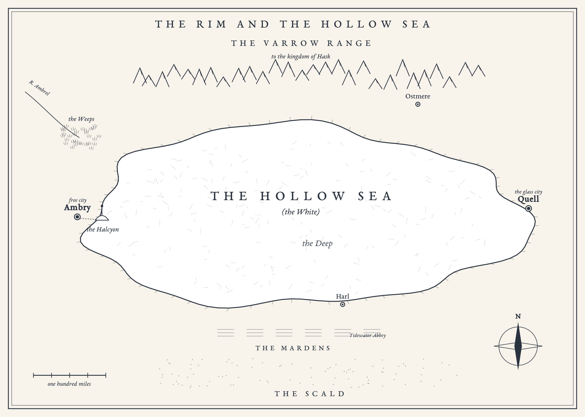
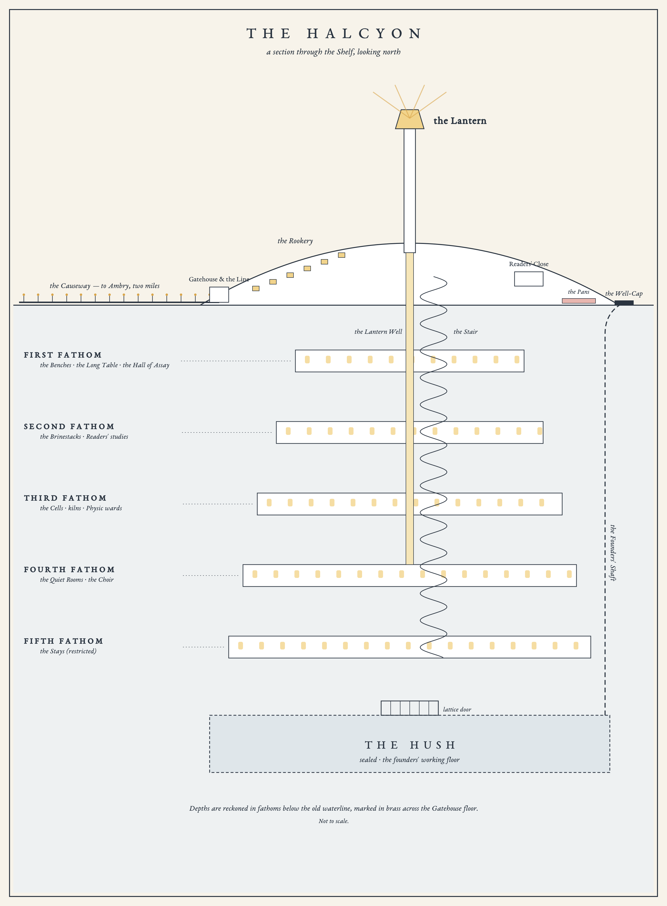

# A Companion to the Halcyon and the Rim

*Being a Brief Account of the Hollow Sea, Its Shores, Its Salt, and the Collegium That Studies It; Compiled in the Brinestacks for the Use of New Aspirants*

*Second Fathom, the Halcyon Collegium of the Grain. Turning Intake, 903 Y.E.*

> *What is kept is not lost.*
> — Motto of the Halcyon

## I. How to Use This Companion

You have stepped over the Line, or you soon will. You will be cold for three years, thirsty for longer, and asked a great many questions you cannot yet answer. This Companion is meant to spare you not knowing what everybody else assumes you know: where Harl is, what a fleck will buy, and why the second-years cheer when you weep at the Long Table.

The Companion moves from the land and its past, through the Halcyon and the craft of grain-work as the Primer teaches it, to the law, the street, the creatures of the White and the persons an aspirant will hear named in the first weeks. A Glossary and a Calendar close the volume.

The compilers have set down what is taught and commonly believed. Where scholars disagree, both views are given. The Brinestacks keep the arguments; they do not settle them.

Do not read it in the Reading Wells, where the brine will spoil the binding.

## II. The Rim and the Hollow Sea

### The Shape of the Land

The **Hollow Sea**, called by everyone who lives beside it **the White**, is a long basin floored with salt, some three hundred miles from east to west and one hundred and twenty from north to south. Its surface is white, glazed and flat beyond the eye's patience. It is cracked into plates a few yards across, which Rim folk call **tiles**, and in the dry season, as the night air cools them, the tiles tick and chime against one another. This is the **night-chime**, and those who grow up within earshot of it say they cannot sleep without it.

The crust is a few feet thick at the margins. How thick it is at the centre no one knows; borings have gone down nine hundred fathoms without striking rock. The habitable band that rings the White is **the Rim**, divided by custom into Western, Northern, Eastern and Southern Rims.

### Hazards of the White

No aspirant should walk out on the White without knowing its four dangers: **sinks**, soft brine pockets beneath the crust that swallow carts and people without warning; **whiteouts**, or salt storms; **glare-blindness**, the reward of crossing in high sun without smoked glass; and **the Pull**, a mirage of the flats that makes distances lie.

### Climate

Summers are hot and dry, winters cold and clear with hard frosts. Autumn rains on the Rim are brief, and on the White it almost never rains. In autumn the **Sere**, a dry east wind, carries salt dust into every hinge and shutter of Ambry.

### Places of the Rim, A to Z

**Ambry.** The largest free city of the Rim, with some 180,000 souls, standing on the Western Rim. It is built on the old western shore, its lower districts on the former seabed, in grey stone and salt-glazed brick under steep roofs. Its districts climb from **Lowside**, by the sea-wall, through the cobbled **Middle Ward** to the **Upper Ward**. Visitors should know the **Glassmarket**, the **Exchequer Yard** where the grain-houses stand, the **Corn Exchange**, and the **Eastgate**, from which the Causeway runs to the Halcyon.

**The Ambrel.** The river that once fed the sea at Ambry. It now ends north of the city in the brackish marshes called the Weeps.

**The Causeway.** A raised road of stone and salt, two miles long, running from Ambry's Eastgate across the margin of the White to the Halcyon Gatehouse. It is lit at night by posts of kept light and crowded by day with ox-drays.

**The Cold House.** The common name of the Ambry Charitable Brinery on Coldwater Street, at the very bottom of Lowside, where the street ends at the old sea-wall. Once a customs warehouse, it opened as a charity brinery in the Great Bloom of 788. Its charity ward holds some three hundred casings in long rows, at six sols a month, the lowest fee in the city. Over its door a board reads *The living keep clear*.

**The Deep.** The uninhabited heart of the White, where the crust is thickest and the borings find no bottom. No town stands on it. Only the Wend cross it, on routes that change with the seasons.

**The Dry Harbour.** Ambry's old harbour, dry these nine hundred years. It keeps its curved quay of black Marrane stone, its bollards and its taverns, the Anchor, the Mermaid and the Drowned Man. Steps go down from the quay to where the water was and simply stop, and landships moor on raked ramps of salt with their bowsprits over the quay. Three faint tide-marks on the harbour wall are, Lowside children are told, the sea's fingers, where it held on before it went. The **Ambry Customs House** stands here.

**Harl.** The chief town of the Southern Rim, set among farmland on dried river deltas. Harl is devout, hospitable Tider country, and its wheat, called Harl grain, feeds the Rim.

**Hask.** The mountain kingdom of the Varrow Range on the Northern Rim. Hask sells timber, furs and honey, makes the best clocks and watches on the Rim, buys kept medicine, and is a known source of mercenaries.

**Lowside.** The lowest district of Ambry, built on the old seabed below the shore-line. It is home to brine-boilers, dock labourers, delvers and laundresses, who say the Halcyon takes their cleverest children and returns them Settled at fifty. At the district's north edge stand the **Lowside Pans**, thirty iron pans under thirty chimneys, where marsh-brine from the Weeps is boiled down into dead salt for the table.

**The Mardens.** The canal country of the Southern Rim near Harl, famous for its bitter-oranges. The mother house of the Order of the Returning Tide, **Tidewater Abbey**, stands among its fields.

**Ostmere.** A town at the passes of the Varrow Range on the Northern Rim, through which Hask's trade comes down to the White. It is a member of the Rim Concord.

**Quell.** The glass city of the Eastern Rim, with some 70,000 people. Quell glass is the best in the world. The city is the seat of the **Quell Lodge**, the Halcyon's rival, and Ambry's commercial rival in everything.

**The Scald.** A red desert lying south beyond Harl and the Mardens.

**The Shelf.** The salt dome, some eighty feet high, that rises from the White two miles east of Ambry. It is also called **the Knoll**. The Halcyon is carved downward into it. *Shelf* also names the shallowest grade of grain.

**The Varrow Range.** The snow mountains of the Northern Rim. Their mines yield rock-salt, which keeps nothing and is called dead salt. The Range is home to the kingdom of Hask.

**The Weeps.** The brackish marshes north of Ambry where the Ambrel loses itself. A flume on black trestles carries marsh-brine from the Weeps to the Lowside Pans. Small green weep crabs live there in great numbers.

**The White.** The common name for the Hollow Sea, and the name you will hear most. Its margins are dotted with brine pools tinted rose-red and copper-green, called **pinkwater** and **greenwater**.

## III. A Short History of the Rim

The Rim reckons its years from the Ebb: **Y.E.**, Years of the Ebb. The present year is 903.

### Before the Ebb

Before the Ebb there was an inland sea, rich in fish, on which the coastal kingdoms of the **Marrane** traded. The Rim's oldest families are Marrane by descent. Few records of that age survive, and the Rim ballads are the best memory of it most people have.

### The Ebb, 0 Y.E.

In one night the sea withdrew and left salt. Most coastal people survived, for the water went rather than came. What caused the Ebb is not known. The **Order of the Returning Tide** teaches that the sea withdrew in judgement and will return when the Rim is reconciled. The Readers teach that the cause is unknown. The compilers record that the question is open.

### The Founding of the Halcyon, 3 Y.E.

Three years after the Ebb, a company of salt-workers settled on the Shelf "to study the gift of the Ebb," under their **First Reader, Ysolde**. Their first workings were cut into the dome where the Halcyon still stands. They chose the motto *What is kept is not lost*, and the emblem of the halcyon bird on a single wave.

### The Spread of the Grain, c. 40–90 Y.E.

The first **Brineries** were founded, and grain-work became a trade, a medicine and a fortune.

### The Charter of the Grain, 140 Y.E.

The Rim League granted the Halcyon the **Charter of the Grain**, which gave it the sole right to license grain-work on the Rim and to certify the grades of grain.

### The Salt Exchequer, 212 Y.E.

The **Salt Exchequer** was founded in Ambry to tax grain.

### The Brinestacks Fire, 230 Y.E.

A great fire in the Halcyon's library destroyed most of the records of the founding years and of the time before the Ebb. What survived is kept in the **Founders' Gallery**.

### The Delving Wars, 341–349 Y.E.

A labour revolt of the miners, ended by the **Delvers' Guild Accord**.

### The Quell Schism, 512 Y.E.

A third of the Readers, led by **Aster Quell**, left the Halcyon in protest at its secrecy and founded the **Quell Lodge** in the city of Quell. The Lodge has been barred from the Charter ever since.

### The Red Grain Murders, 611 Y.E.

A Reader named **Mattias Horne** used human salt, the salt of tears and blood, to make keepings of his victims that no one but he could open. The art he used, **Sanguine Grain**, was banned outright, and its practice is now a capital crime.

### The Great Bloom, 788 Y.E.

An epidemic of lung-fever, the **bloom**, swept the Rim. The Brineries overflowed with the dying, and the **Cold House** opened in Ambry as a charity brinery for those who could not pay a private house.

### Sorle's Folly, 871 Y.E.

Reader **Benedek Sorle** of the Horology Bench presented his **Held Moment Hypothesis** to the Conclave of Readers: the proposal that stillsalt carries stillness because it is, in some sense, a held moment, rather than a mineral with a peculiar property. The Conclave rejected the Hypothesis and censured him, and the episode is remembered as "Sorle's Folly." Aspirants will hear opinions on whether the name is just, most of them loud.

### The Present Day, 903 Y.E.

There has been no great war on the Rim in two hundred years. The live questions of the day are these:

1. the Held Moment Hypothesis against the orthodox **Mineral Theory**;
2. the Exchequer's pressure for deeper mining, against Delver safety and Tider objection;
3. the fee economy of the Brineries, and Lowside's agitation for a free keeping law;
4. the Quell Lodge's petition to break the Charter;
5. the **Stillborn Clause**, and whether a person kept beyond return is dead;
6. the Brinestacks Fire of 230, and what was lost in it.

## IV. The Halcyon

### Name, Emblem and Mission

The full style of the institution is **the Halcyon Collegium of the Grain**. Everyone calls it the Halcyon.

Its emblem is a **halcyon**, a kingfisher-like bird of the old sea, perched on a single wave drawn as a straight line. The legend says that the halcyon nested upon the waves, and that while she brooded the sea lay still. No halcyon has been seen on the Rim in living memory, and the bird is known only from the emblem and from old pictures.

The Charter states its mission as "to study, regulate, and preserve the gift of the Ebb for the good of the Rim." In practice the Halcyon is a school (the only one that can train the grain-sense), a regulator, a mine (with the only access to the deep grain beneath the Shelf) and the Rim's great house of research.

### The Plan: The Halcyon Fathom by Fathom

The Halcyon is cut downward into the Shelf. Depth is measured in **fathoms below the old waterline**, marked by a brass strip in the Gatehouse floor called **the Line**. Its carved salt is smooth, translucent at the edges and faintly pink in lamplight.

**The Crown (the surface).**
- **The Gatehouse** stands where the Causeway ends. The Line runs across its floor.
- **The Lantern** is a tower of salt-glass and iron two hundred feet tall. Its mirrors turn all day to send the sun down the **Lantern Well** into the dome.
- **The Rookery** is the student lodging: terraced cells cut into the dome's western flank, each with a salt-glass window looking over the White toward Ambry. Aspirants lodge two to a cell. It is cold.
- **The Readers' Close** holds the faculty houses, built of stone on the lee side of the dome.
- **The Pans** are practice evaporation ponds, coloured rose and green, used in Keeping and Lumen practicals.
- **The Choir Steps** are an outdoor amphitheatre of salt, where the Stay Choir rehearses in summer.

**The First Fathom: Teaching.**
- **The Benches** are the lecture rooms. Their salt seats are worn hollow by nine centuries of scholars.
- **The Long Table**, the refectory, is a single table three hundred feet long, carved from the living salt directly under the Lantern Well.
- **The Hall of Assay** is a great domed hall hung with salt chandeliers, lattice-grown and lit from within by kept light. The Midwinter Assay is held here, before public galleries.
- **The Proctory** houses the Chief Proctor's office and cells.

**The Second Fathom: The Brinestacks.**
- The library holds some 300,000 volumes and about 40,000 **brinescripts**, salt tablets bearing text and kept impressions.
- **The Reading Wells** are small chambers with brine basins, in which tablets are read.
- **The Callow Desk** is the station of the Under-Archivist, Wynn Callow, who sits so still that aspirants mistake him for furniture.
- **The Founders' Gallery**, which is restricted, holds what survived the fire of 230.
- The Readers' studies line the outer galleries.

**The Third Fathom: The Cells.**
- Private workrooms of the Readers.
- The kilns and light-presses of the Glaziers.
- **The Physic wards**, the Halcyon's own small brinery for its staff and students.
- **The Lattice Yards**, where masons grow salt arches.

**The Fourth Fathom: The Quiet Rooms and the Choir.**
- **The Quiet Rooms** hold the Halcyon's own collection of kept things. Among the best known are a kept rose of 304 Y.E., still in bloom; the "Last Breath" of First Reader Ysolde, a puff of kept breath in a glass sphere; and a kept lightning bolt of 712 Y.E., a white fork frozen in the air. Here also lie members of the Halcyon who have been kept to await cures.
- **The Choir** is a vast oval chamber where the Stay Choir practises, and from which it descends to the Stays.

**The Fifth Fathom: The Stays.**
- A labyrinth of galleries, restricted to Fathomers, where the Halcyon holds its **quickenings** (see Part VI). Each Stay is fed from the Choir above through **stay-lines**, brine channels sheathed in brass.
- **The Warden's Gallery** is the command post of the Warden of the Lower Fathoms.

**Below the Fifth: The Hush.**
- The founders' original working floor, sealed behind a lattice door bearing the founders' emblem. Grain from this depth is called **Hush grain**. No aspirant goes below the Fifth.

**Getting about.**
- **The Stair** is a great spiral that runs from the Crown to the Fifth Fathom. Its walls are chalked with the names of the Settled.
- **The brine-lifts** are cages counterweighted by brine tanks. They are slow, and they creak.

### The People of the Halcyon (903 Y.E.)

| Rank or body | Number |
|---|---|
| Chancellor | 1 |
| Deputy Chancellor | 1 |
| Wardens (of the Upper Fathoms, the Lower Fathoms, the Stacks, the Light) | 4 |
| Readers (faculty) | about 60 |
| Fellows (assayed researchers) | about 400 |
| Aspirants (students, years one to three) | about 300 |
| Proctors | about 80 |
| Staff (delvers, porters, cooks, clerks) | about 600 |

Aspirants range from about twenty to forty-five years of age, with a median of twenty-six; two in five are women, and many are married or parents. About half are sponsored by the Exchequer or a guild, a third pay their own fees, and a sixth come on scholarships, bursaries or the Reader's Privilege.

### The Hierarchy

The ladder has five rungs: **Aspirant** (three years, with an Assay each midwinter); **Fellow** (after the third Assay); **Reader** (by election of the Conclave); **Warden** (by the Chancellor's appointment); and **Chancellor** (elected for life by the Conclave). **The Conclave of Readers** governs academic affairs.

### Factions Within

The **Charterists**, the majority, defend the Charter and work closely with the Exchequer. The **Reformers** want an open Charter and free keeping for the poor. The **Fathomers** care for safety and little for politics. **The heterodox**, few in number, hold with the Held Moment Hypothesis and are not invited to dinners.

### The Bench System

Every aspirant must be sponsored on a **Reader's Bench**, and a Reader may sponsor no more than six. The rule is absolute: **an aspirant without a Bench at the Midwinter Assay is sent down.** The Bench is shown by a coloured **benchcord** on the grey gown (see Part V).

**The Reader's Privilege.** Once in ten years a Reader may admit one candidate without fees, subject to the Entry Assay.

### Admission

The **Entry Assay** is a blind test of the sense: identify grains by grade and depth, find a kept object among unkept ones, and attempt a first hold. Candidates need fees (120 sols a year) or a sponsor. The **Turning Intake** matriculates in autumn and is the larger; the **Thaw Intake** matriculates in spring.

### The Midwinter Assay

Held on the shortest day, **21 Rime**, in the Hall of Assay, before galleries full of families, it is something between an examination and a theatre. Each aspirant performs three tasks before a panel of Readers:

1. **Discernment:** to identify unknown grains.
2. **Keeping:** to keep a set object, such as a falling drop, a flame, or a moth.
3. **Return:** to return that same keeping cleanly.

The verdict is announced aloud, in one of four forms: **Assayed**; **Assayed with distinction**; **Wanting**, which permits a resit; or **Sent down**.

### Traditions and Ceremonies

**Stepping the Line.** On Matriculation Day each aspirant steps over the Line, "going below the sea."

**The First Taste.** On the first night, the Long Table is laid with five dishes, one grain from each Fathom, and each aspirant tastes all five to the cheers of the second-years. The deepest dish makes nearly everyone weep salt tears, which is what the second-years are cheering.

**The Lantern Hour.** Each day at dusk the Glaziers release a measure of kept noon light down the Lantern Well, and the refectory fills with daylight at nightfall.

**Lantern Night (30 Russet).** On the first night longer than day, the Halcyon releases a summer's worth of kept light over Ambry. It is the city's great festival.

**The Silent Supper (9 Cinder).** The whole Halcyon holds still for one minute, called **the Minute**, in memory of the Settled. That night the names on the Stair walls, the **chalk-names**, are written fresh.

**The Ebbtide Vigil (30 Rime).** A Tider holy night, observed informally by many aspirants (see Part VII).

### Student Life

The aspirant's life is cold, thirsty and crowded. Wool is worn in every season, water carried everywhere, and **saltcake** baked, against regulations, in the Rookery. **The Stay Choir** recruits aspirants with strong holds at a stipend of three sols a week; the work is dangerous, and popular with poor students all the same.

### Societies

- **The Thirsty Society.** A drinking and debating club, founded 600 Y.E. Its motto: *Drink, for tomorrow we settle.*
- **The Lowside Bench.** A mutual-aid society for scholarship and Lowside aspirants. It meets in a disused brine-lift engine room.
- **The Glaziers' Guildlet.** For students of Lumen. Rich and showy.
- **The Open Grain Circle.** Illicit and pro-Quell. The compilers decline to say where it meets.

## V. The Disciplines

The Halcyon teaches thirteen disciplines and forbids a fourteenth. All first-years share the courses in Keeping and Horology.

**1. Keeping (brinewrighting). Cord: blue.**
The foundational art. Keeping rests on the First Law and on the worker as template: the casing takes the shape of what the worker intends to hold. Brinewrights practise the drop-keep, the shell-keep and the sleeve, or partial keeping, and every Brinery depends on them. The Bench's great ethical question is consent. Reader **Maudelaine Crisp** teaches the first-year course, and teaches that "the hold is a posture, not a feeling."

**2. Reading (lection). Cord: green.**
The art of the Second Law: perceiving the impression a kept moment leaves in its salt. Readers practise cold-reading, deep-listening and the double read, and serve courts and historians. Impressions fade with age and are masked in old grain by the Roar. The Bench argues over kept testimony and the privacy of the read dead.

**3. Returning (solution). Cord: white-blue.**
The art of the Third Law: dissolving a keeping so that the kept thing resumes. Its great difficulty is discharging arrears safely, by the slow bath and staged dissolution. Its hardest questions are legal, chief among them the Stillborn Clause.

**4. Assay. Cord: white.**
The art of reading grade, depth and age in grain. Assayers practise the tongue-test, the weight-sense and cold-dating, and their certificates underwrite the grain trade. Fraud is their daily concern. Reader **Corvin Aske** holds the Bench and the office of Inspector of Trade Grain, and his saying is "the salt doesn't lie; people label it."

**5. Lattice (salt masonry). Cord: brown.**
The art of growing grain along a template. The Halcyon's arches and the few bridges on the White are Lattice work. Damp is its enemy, and the safety of delvers beneath grown roofs its conscience.

**6. Fathoming (deep pressure). Cord: iron-grey.**
The study of pressure in the deep grain, and the work of keeping the deep galleries safe. Fathomers are trained in sounding, the Stay and the Choir, and serve the safety of mines as well. The Bench's ethics turn on the Settle of its choristers. **Warden Orsolya Thane** of the Lower Fathoms holds the Bench.

**7. Brinescript. Cord: ochre.**
The art of cutting text into salt tablets together with a kept impression of the scribe's moment, for archives and contracts. Damp is its enemy, and it mourns the Fire of 230 more than any other Bench. **Deputy Chancellor Ilario Vey** is a Reader of this Bench.

**8. Lumen (glazing). Cord: gold.**
The art of keeping light. Glaziers practise sun-pressing and lantern-cutting, and supply the lantern trade and Lantern Night. Kept light is a luxury, and a perennial target of the tax-man. "Light wants to be spent," says Reader **Ottavio Bassano**, who holds the Bench and wears a ring on every finger.

**9. Physic. Cord: red.**
Keeping as medicine. Physicians of the grain keep the dying until cures may be found, hold haemorrhages and numb limbs with partial keepings. Their first lesson is the hardest: keeping does not heal. The Bench is entangled in the fee economy of the Brineries.

**10. Cellaring. Cord: green-brown.**
The art of preservation for trade. Cellarers keep fish, fruit and milk in bulk with cheap grain, and quarrel with the Exchequer over quotas.

**11. Horology (the theory of moments). Cord: black.**
The theory beneath all the disciplines. Horology concerns the Fourth and Fifth Laws and the **arrears calculus**, and asks what every other Bench takes for granted: what *is* stillness? It is the home of the quarrel between the Mineral Theory and the Held Moment Hypothesis. Reader **Benedek Sorle** holds the Bench, and is fond of saying that "every keeping is a lie we tell time, and time collects."

**12. Weathering (salt-weather). Cord: sky-blue.**
The study of the White's behaviour: its sinks, its whiteouts and its moods. Weatherers practise tile-reading and wind-salt, and serve landship navigation and survey. Their forecasts are humble.

**13. Sonance (kept sound). Cord: violet.**
The keeping of sound in grain. Sonancers practise jar-keeping and the open ear, and make the kept-sound recitals. Grain hiss limits every recording.

**14. Sanguine Grain. No cord. Forbidden.**
Sanguine Grain was the art of working human salt, the salt of tears and blood, together with grain, so as to *key* a keeping to a single person: such a keeping would open for that person and for no one else. After the Red Grain murders of 611, in which Reader Mattias Horne made unopenable keepings of his victims, the art was banned absolutely. It is not taught, and its practice is a capital crime. It is named here only so that the aspirant may know the reason for its absence.

## VI. Grain-work: A Primer

This part summarises the Halcyon Primer. It is no substitute for your Keeping and Horology lectures, and no aspirant should attempt a hold on the strength of it.

### Stillsalt

Salt from the Hollow Sea, called **stillsalt** or simply **grain**, can hold a thing still in time. Salt from anywhere else, whether rock-salt from the Varrow or salt boiled from foreign water, is **dead salt** and keeps nothing.

Why it does so is officially unknown. The orthodox **Mineral Theory** holds that stillness is a mineral property formed under the unique pressures of the Ebb. The heterodox **Held Moment Hypothesis** holds that the salt *is* a held moment. The Benches still argue it.

### The Grades

The Exchequer schedule grades grain by the depth from which it comes.

| Grade | Depth | Uses | Price (903) |
|---|---|---|---|
| **Shelf** | surface to about 3 fathoms | food, curing, cheap keepings of hours to weeks | 2 flecks the dram |
| **Middling** | about 3 to 40 fathoms | trade keepings, records, ordinary kept light | 1 sol the ounce |
| **Deep** | about 40 to 300 fathoms | medical keepings of people, long archives, fine lumen | 12 sols the ounce |
| **Hush** | below the Fifth Fathom | restricted; never sold | (none lawfully) |

Deeper grain is stiller and stronger, and colder to the hand; the Readers who handle Deep grain wear gloves. **Hush grain** is enormously still and enormously pressured. It keeps almost instantly, but its arrears are monstrous. Its sale is a felony under the Charter, and the customs schedule of Ambry will not receive a declaration of it, "there being none lawfully for sale."

### Live Brine

Grain does nothing dry. Dissolved in water it becomes **live brine**, which must be worked within minutes or it **dies**: the stillness disperses into the water and leaks away at the surface.

### The Grain-sense

Grain-work requires the **grain-sense**, the perception of stillness. Perhaps one person in three hundred has a usable sense, and one in five thousand a strong one. Most hear stillness as **pitch**, the deeper grain the lower note; others feel it as **pressure** or **cold**, or **taste** it. Each worker leaves a characteristic pattern in their casings, called their **hand**.

### The Three Operations

**Keeping.** The target is wetted with live brine by spray, pour or bath; nothing can be kept that the brine does not touch. The worker enters the hold and lends stillness to the brine, which crystallises into a **casing** and keeps the target: paused, unchanging, and alive if it was alive.

**Reading.** In the hold, a worker in contact with kept salt perceives the impression of what it kept: images, sounds, sensations, temperature. Old grain of the White carries beneath any impression a low continuous rushing called **the Roar**, like the sound in a shell held to the ear. The orthodox account calls it residue: the noise of the Ebb and of the crust forming, caught in the salt as it set.

**Returning.** The worker dissolves the kept salt in the **release** and the kept thing resumes from exactly where it paused.

### The Five Laws (as taught in the Primer)

1. **Salt keeps.** Live brine, worked in the hold, crystallises around a target and keeps it in its present state.
2. **Salt remembers.** Kept salt holds an impression of what it kept.
3. **Salt returns.** Kept salt dissolved in the release gives its moment back.
4. **What is kept is owed.** This is the **Law of Arrears**. A keeping accrues pressure in proportion to the mass kept, the duration of the keeping and the liveliness of what is held. Living things accrue faster than stone, and motion faster than rest. Arrears discharge on return as heat, as sound, as a pressure shock called **the snap**, and in great keepings as violent motion.
5. **Still runs to quick.** Taught in the first year in Horology and Fathoming. Stillness moves through *physically continuous live brine* from the stiller to the quicker, as heat moves through metal from hot to cold. It does not jump gaps. There are no symbolic or sympathetic links of any kind. Dry salt, glass and air insulate.

To these Reader Sorle adds a **corollary**, which first-years are expected to know: *old keepings grow stiller over time.* They saturate. Old human keepings are among the stillest things in the world.

### The Hold

The **hold** is a deliberate bodily stillness: slow the breath; drop the heart rate; quiet the muscles; still the attention. Depth gives a keeping its strength, steadiness its precision, and *shape*, what the worker intends to keep, the form of its casing.

### The Release

The **release** is the hold reversed: the worker *gives up* stillness, letting go of intent while in contact with the keeping in brine. Most find it harder than the hold, and those who like control find it hardest of all.

### The Worker's Costs

**Lag.** After a significant hold the worker **lags**: seconds or minutes in which they are effectively paused, unaware and unmoving. A strong worker keeping a person for the first time may lag two to five minutes, and cannot react to anything meanwhile.

**Cold and thirst.** Holds chill and dry the body; hence wool in every season, and **the Halcyon thirst**.

**The rush.** Releasing a large keeping hands the worker back a surge of motion: heat, a racing heart, sweat that will not salt, and a sensation of time flaring forward, with sounds too fast and light too bright. A minor release gives only a flush. A major one can stop the heart by overdriving it. *Lag is the cost of keeping; the rush is the cost of letting go.*

**The Settle.** Over a career, lent stillness does not fully return. The joints stiffen, the heart slows, tears leave salt crusts, the hair whitens early, and the worker begins to sit for long spells without noticing, called **drifting**. Final Settle is death by stillness. A heavy career lasts twenty-five to thirty-five years, and the Stay Choir settles fastest.

### Arrears and the Snap

Every keeping must be paid for on return. A day-old keeping of an apple returns with a faint warmth. A decade-old keeping of a person returns with heat, a cracking sound and a pressure that can break bones unless the keeping is dissolved gradually. Medical returns of people are therefore made slowly, over hours, in warm brine baths, by the Physic Bench. *Return is never instant for anything large or living.*

### Keeping Does Not Heal

**Keeping does not heal. Returning does not heal.** A dying man who is kept returns dying. The Brineries keep the sick to wait for cures, and the cures do not always come.

### "The Living Keep Clear, the Dead Keep Grey"

A casing around a living body stays clear, often so clear that one forgets it is there. A casing around a body that was dead or dying at the moment of keeping develops within days a pearly grey cloud called the **death-bloom**. Every keeper of a Brinery watches for it, and the rule is written above the door of the Cold House.

### Weeping and Recasting

Brine beading on the surface of a casing is called **weeping**. It means the casing is losing stillness faster than it holds it. It comes with age, damp or cracking, slowly and evenly, like sweat on a cold jug, and is seen on very old keepings in summer. A weeping casing left alone thins, cracks and returns its sleeper, which the Brineries call **coming back**. The remedy is **recasting**: adding fresh brine and stillness to the failing casing.

### Partial Keepings, Spitting and Quickenings

**Partial keepings**, of a wound, a limb, a sound in a jar, are possible but fragile, and their boundaries tend to fracture.

**Spitting** is the small shock that unstable grain gives off when it is dissolved.

**Quickenings** are a known phenomenon of the deep grain and the chief business of the Fathoming Bench. A quickening is a place where the stillness of the deep grain gives way and the grain begins to stir. Its signs come in a rising order: warmth; then **live beads**, which are inclusions of liquid water moving inside the crystals; then wet salt; and at last moving brine. Grain taken from near a quickening, called **quickened grain**, is unstable and prone to spitting. Assayers who can taste it say it is sweet, metallic and wet, like a bitten tongue, and call it **quick**.

The orthodox treatment of a quickening is **the Stay**: a re-keeping that adds stillness to the pocket. It is supplied through the stay-lines by a team of workers holding in synchrony, the **Stay Choir**, who sing slow to lock their breathing together. A stayed pocket is quieted for a time, and must be watched.

### Arrears of the Purse

"Arrears" has two senses on the Rim: the pressure a keeping owes to time, and the fees a family owes a Brinery, paid monthly for years or decades. Lowside will tell you the second is heavier.

## VII. Institutions and Law

### The Charter of the Grain

Granted in 140 Y.E., the Charter gives the Halcyon sole right to license grain-work and certify grades. Its offences, in ascending gravity:

- **unlicensed keeping**;
- **falsified grading**, which is fraud;
- **sale of Hush grain**, which is a felony;
- **improper return of a kept person**, which is homicide;
- **Sanguine Grain**, which is capital.

### The Salt Exchequer

Founded in 212 Y.E., the Salt Exchequer taxes and trades grain, holds the export licences, keeps the grade schedule and employs the **excisemen** of the quays. It is led by the **Lord Exchequer**, at present Aurel Ferrers.

### The Delvers' Guild

The miners' union of the Rim, recognised by the Accord that ended the Delving Wars. The Guild mines grain under Halcyon licence and can halt supply by strike. Collapses and sinks kill delvers every year.

### The Assize

Ambry is a free city governed by the **Assize**, a council of thirty-one representatives of the guilds and wards, with a **Lord Mayor** chosen each year. The **Assize Court** hears city matters. It is commonly said that the real power in Ambry rests with three bodies, the Halcyon, the Exchequer and the Delvers' Guild, and that the Assize presides over their quarrels.

Beyond Ambry, the **Rim Concord** is a loose treaty league of the Rim cities (Ambry, Quell, Harl and Ostmere) for trade and mutual defence, with a weak **Concord Diet**.

### The Proctory

The Halcyon's own police. Some eighty **Proctors** under a **Chief Proctor**, at present Halloran Gage, a former soldier of the Concord, police grain crime and keep order in the Fathoms. Offences by the Halcyon's own members are tried in the **Proctory Court**. Proctors are disliked in the city, and aspirants are advised not to test their patience.

### The Order of the Returning Tide

The Tiders teach that the sea withdrew in judgement and will return when the Rim is reconciled. They oppose deep mining, holding that it wounds the sea's bed. They keep their dead **unkept**, refusing brining, for they believe the kept cannot meet the returning sea. The Order runs abbeys, hospices and charities from its mother house at **Tidewater Abbey**, and some lay Tiders work in the Brineries all the same, tending keepings as "the people's choice."

### The Quell Lodge

Founded at Quell after the Schism of 512, the Lodge is the Halcyon's rival academy. It is more open, poorer and more radical, and it is barred from the Charter. Its philosophy, the **Open Grain**, holds that knowledge of the grain should be shared and that the Charter is a tyranny. The Lodge has petitioned to break the Charter; the petition is a perennial in the Concord Diet.

### Kept-Person Law and the Stillborn Clause

A kept person is **legally alive** while their casing is clear. Next of kin may sign for a keeping and for a release; the kept person's own wish is not legally required if they are incapacitated. Courts may also accept **kept testimony**, impressions read from salt, under strict rules.

The **Stillborn Clause** treats a person kept beyond return, that is, kept in grain so deep that return would kill them by arrears, as legally dead. Their estate passes to their heirs, and their casing becomes the property of the Brinery or of the Halcyon. Lawyers dispute whether such persons are dead in any sense but the legal one, and the dispute is among the liveliest on the Rim.

## VIII. Daily Life

### Money

The coin of the Rim is the silver **sol**, divided into twenty copper **flecks**. A worn sol weighs about a fifth of an ounce. A gold **crown** is worth twenty-five sols and is rarely seen in Lowside.

Some prices and wages of 903, for the aspirant's orientation:

| Item | Cost |
|---|---|
| A customs assayer's wage | 14 sols a month |
| A dock labourer's wage | about 7 sols a month |
| A Stay Choir stipend | 3 sols a week |
| Cold House charity keeping | 6 sols a month |
| A private brinery | 30 sols a month and upward |
| Halcyon fees | 120 sols a year |

### Trade

Grain and kept goods; kept light; Quell glass; Harl wheat; Hask timber and furs; landship-building; and brine-boiling, for dead table salt.

### Travel

**Landships**, also called salt-yachts, are wind-driven sledges on iron runners that sail the White. They range from two-person skiffs to three-masted freighters and make twenty knots in a good wind. **Ox-drays** carry the overland trade.

### Food

- **Kept-fish:** perch and eels from the Hask lakes, sold kept.
- **Salt-crust bread.**
- **Brine-pickles.**
- **Pinkwater shrimp paste.**
- **Harl wheat porridge.**
- **Saltcake:** caramel cake with crisp salt flakes, the aspirant's staple.
- **Hask honey.**
- **Bitter-orange** from the Mardens.
- **Halcyon tea:** black tea with a pinch of shelf salt and milk. An acquired taste.

### Drink

Small beer; Harl cider; and **Quell clear**, a fierce spirit not to be taken before an Assay. Water is precious on the White.

### Clothing

Grain-workers wear wool all year round. The **Halcyon gown** is undyed grey wool, with a coloured **benchcord** at the shoulder for the Bench. Customs officers wear blue. Lay sisters of the Tide wear a grey shawl with a brass wave at the throat.

### Keeping Time

The day is told in **bells**, from the **first bell** at dawn to the **twelfth bell** at night. The prosperous carry Haskish watches; everyone else listens for the bells or watches the Lantern's flash.

The year is reckoned in months of thirty days. Aspirants of the Turning Intake will live their first term through the four months of the dark half of the year:

- **Russet**, the first month of autumn, when the Sere blows and the Turning Intake matriculates. It ends with Lantern Night.
- **Fallow**, the second month of autumn.
- **Cinder**, the first month of winter, which holds the Silent Supper.
- **Rime**, the deep of winter, which holds the Midwinter Assay and closes with the Ebbtide Vigil.

The spring months, among them **Seedmonth**, belong to the Thaw Intake, and to a later edition of this Companion.

### Sayings and Oaths

- **"Sere's in."** Said to one another on the first of Russet. A greeting, a complaint, and a fact.
- **"Mind the step."** A farewell in Lowside, meant kindly.
- **"Tide willing."** Hope, with a Tider flavour, used by the devout and the undevout alike.
- **"Tide take it."** An oath of annoyance.
- **"Salt and sorrow."** An oath of grief or dismay.
- **"Still as a Reader."** Said of anyone who will not move.
- **"Sweet sea."** A mild Lowside exclamation.
- **"Harl grain or Halcyon grain?"** The Rim's oldest pun, asked of anything ambiguous.
- **"Come back."** The Brineries' phrase for a sleeper who returns, by intention or by a failed casing.
- **"Wants doing,"** **"I'll not,"** and **"ta"** are Lowside for "must be done," a refusal not to be argued, and thanks.
- **"What is kept is not lost."** The Halcyon's motto, and the creed of what is sometimes called **Civic Stillism**: preservation as civilisation, and the past as a resource.
- **"Drink, for tomorrow we settle."** The Thirsty Society. Aspirants are not obliged to agree.

## IX. Creatures and Ecology of the White

The White is not empty, though it looks it. Life gathers at the margin pools.

**Brine shrimp.** Tiny crustaceans of the brine pools that bloom red in season and colour the pinkwater. They are scooped and ground into pinkwater shrimp paste.

**Halophile algae.** The salt-loving weeds of the margin pools, which tint the water rose-red and copper-green. The colours lie in bands along the shore, pink and green and pink again, and are brightest in the low sun of autumn mornings.

**Lurchers.** Lean Rim hounds bred to sense sinks. A good lurcher will stop dead and refuse to go on where the crust is soft, and every experienced walker of the White obeys its lurcher before its map.

**Pale herons.** Tall wading birds with pink crests, which stand motionless in the pinkwater and fish for shrimp. A common emblem of patience.

**Salt-flies.** Small biting flies of the margins. They are worst in late summer, and there is no remedy for them but wool and patience.

**Salt-larks.** Small white birds that nest on the margins of the brine pools. A stuffed salt-lark is a common ornament in Ambry rooms.

**Salt roses.** Not creatures but crystal formations, which "grow" on the crust in a single night after the rare rains. Finding one is a sign of luck.

**Weep crabs.** Small green crabs of the brackish marshes of the Weeps, plentiful, cheap and good in a stew.

**The night-chime.** The singing of the salt tiles at night in the dry season, as the cooling crust contracts. It is less a sound than a slow scatter of high, glassy ticks and chimes across the whole width of the dark.

**The Wend.** Not creatures but a people: the nomad salt-walkers of the White, who cross even the Deep on their seasonal routes. They hold the salt sacred and sing to it, and they are reputed to hear the Roar better than anyone.

## X. Notable Persons

### Persons of the Story

**Hester Vail.** Senior assayer at the Ambry Customs House in the Dry Harbour, thirty-three years old, born and raised in Lowside. She began at the Customs House as a sweeper at twelve and learned assay by watching, until she could grade grain by tongue better than most Readers. Her grain-sense is taste and weight: sweetness at the back of the tongue, heaviness behind the eyes. She has never set foot in the Halcyon when the story opens.

**Tobias Vail ("Tib").** Hester's younger brother, kept at the Cold House in 892, at the age of fourteen, in the last weeks of the bloom fever; he lies in casing 211, in the fourth row of the charity ward. He was a bright, mischievous Lowside boy who whistled and drew landships on everything, and he meant to be a landship pilot. His casing is clear, and his sister pays his fee on the first of every month.

**Aldous Vail.** Hester's father, a brine-boiler who has worked pan nineteen at the Lowside Pans for forty years. A widower of sixty-one, short, broad and burn-scarred, he speaks rarely and to the point.

**Mother Agathe (Agathe Linden).** Senior keeper at the Cold House since before the Great Bloom, seventy years old, very small and very upright, and a lay sister of the Returning Tide. She walks the rows twice a day with a soft brush and an oil can, knows every sleeper by name, and talks to them. It is from her that many in Lowside first hear the rule: the living keep clear, the dead keep grey.

**Corvin Aske.** Reader of the Assay Bench and the Halcyon's Inspector of Trade Grain, forty-seven years of age. He is thin, short-sighted behind thick spectacles, ink-stained on both hands, and given to humming while he thinks; he has a gift for delight and very little for politics. He has a reputation for tasting his own experiments, and had never, before the autumn of 903, used his Reader's Privilege.

**Daisy Fenn (Marguerite Fenn).** Hester's colleague at the Customs House, forty-one, round, quick, loud and kind, with five children and the most accurate ledger in the building. She grades Shelf and Middling by eye and crumble, and she knows every trading firm in Ambry.

**Comptroller Mallory.** The supervisor of the Ambry Customs House, a heavy, soft and careful man with a reddish wig. He has a wife and a daughter at the Glassmarket school, and he does not like trouble.

### Public Figures

**Chancellor Perpetua Holm.** Chancellor of the Halcyon, elected for life by the Conclave and now in her late seventies. She appears rarely in public, and speaks in little more than a whisper.

**Deputy Chancellor Ilario Vey.** Deputy Chancellor of the Halcyon and a Reader of the Brinescript Bench. He is known as a smooth and capable administrator, and as a leading Charterist.

**Warden Orsolya Thane.** Warden of the Lower Fathoms and Reader of the Fathoming Bench, and head of the Stay Choir. She is among the most respected figures in the Halcyon, admired by the Fathomers and the Choir alike.

**Reader Benedek Sorle.** Reader of the Horology Bench, of Harlish birth. In 871 he presented the Held Moment Hypothesis to the Conclave, was defeated in the debate and censured, and has borne the name "Sorle's Folly" ever since. He is known as an acid, Socratic and formidable lecturer.

**Lord Exchequer Aurel Ferrers.** Head of the Salt Exchequer, and so one of the most powerful people in Ambry.

## XI. Glossary

**Arrears.** (1) The pressure a keeping accrues, owed on return; see the Fourth Law. (2) Unpaid keeping fees.

**Aspirant.** A student of the Halcyon in the first three years.

**Benchcord.** The coloured cord on the shoulder of the gown that marks an aspirant's Bench.

**Bloom.** Lung-fever. The Great Bloom of 788 was its worst epidemic.

**Brinery.** A house where people are kept, for a fee, to await cures.

**Brinescript.** A salt tablet bearing text and a kept impression; also the discipline that makes them.

**Casing.** The crystallised salt surrounding a kept thing.

**Charter of the Grain.** The grant of 140 Y.E. giving the Halcyon its monopoly of licensing.

**Cold House.** The Ambry Charitable Brinery on Coldwater Street.

**Dead salt.** Salt from anywhere but the Hollow Sea. It keeps nothing.

**Death-bloom.** The grey cloud that forms in a casing around a body dead or dying when kept.

**Deep.** (1) The grade of grain from about 40 to 300 fathoms. (2) The centre of the White.

**Ebb, the.** The withdrawal of the sea in a single night, 0 Y.E.

**Ebbtide Vigil.** The Tider holy night, 30 Rime.

**Entry Assay.** The blind test of the grain-sense by which candidates are admitted.

**Fathomer.** A worker of the Fathoming Bench, guardian of the deep galleries.

**Fellow.** A researcher who has passed the third Assay.

**Grain-sense.** The perception of stillness.

**Halcyon.** (1) The Collegium on the Shelf. (2) The bird of its emblem, said to still the sea while it brooded.

**Hand.** The characteristic grain-pattern a worker leaves in a casing.

**Held Moment Hypothesis.** Reader Sorle's proposal that stillsalt is a held moment. Censured 871.

**Hold, the.** The deliberate bodily stillness in which grain is worked.

**Hush, the.** The sealed founders' working floor below the Fifth Fathom.

**Hush grain.** Grain from below the Fifth Fathom. Restricted; its sale is a felony.

**Keeping.** The act of holding a thing still in salt; the thing so held; and the discipline of it.

**Kept-beyond-return.** Kept in grain so deep that return would kill by arrears; see Stillborn Clause.

**Kept light.** Sunlight held in grain and released by dissolving it.

**Lag.** The lost time, seconds to minutes, after a significant hold.

**Landship.** A wind-driven sledge on iron runners that sails the White.

**Lantern Night.** 30 Russet, when the Halcyon releases a summer's light over Ambry.

**Line, the.** The brass waterline in the Gatehouse floor.

**Live brine.** Grain dissolved in water, which must be worked within minutes.

**Lumen.** The discipline of keeping light. Its workers are **Glaziers**.

**Middling.** The grade of grain from about 3 to 40 fathoms.

**Mineral Theory.** The orthodox view that stillness is a mineral property of the salt.

**Pinkwater.** A margin pool tinted rose-red by algae and brine shrimp.

**Proctor.** An officer of the Halcyon who polices grain crime.

**Pull, the.** The mirage of the White that makes distances lie.

**Quick.** Assayers' word for grain or brine that tastes of motion.

**Quickening.** A place in the deep grain where the stillness gives way and the grain stirs.

**Reader.** A member of the Halcyon's faculty.

**Reader's Privilege.** A Reader's right, once a decade, to admit one candidate without fees.

**Recasting.** Renewing a failing casing with fresh brine and stillness.

**Release, the.** The reversed hold, by which a keeping is returned.

**Roar, the.** The low rushing heard when reading old grain of the White.

**Rush, the.** The surge of heat and speed a worker suffers after a large release.

**Sanguine Grain.** The forbidden art of keying a keeping to a person with human salt.

**Saltcake.** A caramel cake with salt flakes; the aspirant's staple.

**Sere, the.** The dry east wind of autumn.

**Settle, the.** The chronic stillness that accumulates over a worker's career.

**Shelf.** (1) The salt dome of the Halcyon. (2) The weakest grade of grain, from the first fathoms.

**Sink.** A soft brine pocket beneath the crust.

**Snap, the.** The pressure shock of arrears discharged on return.

**Stay.** A re-keeping that adds stillness to a quickening.

**Stay Choir.** The stipended team of workers who hold the Stays in synchrony.

**Stillborn Clause.** The law treating a person kept beyond return as legally dead.

**Stillsalt.** The salt of the Hollow Sea, which keeps.

**Tider.** A member or follower of the Order of the Returning Tide.

**Weeping.** Brine beading on a casing as it loses stillness.

**Wend, the.** The salt-walking people of the White.

**White, the.** The Hollow Sea.

**Y.E.** Years of the Ebb.

## XII. Calendar and Timeline

### The Aspirant's Calendar, Turning Intake

| Date | Occasion |
|---|---|
| 1 Russet | First of autumn. "Sere's in." Brinery fees fall due. |
| 6 Russet | Matriculation Day of the Turning Intake; Stepping the Line; the First Taste. |
| Daily, at dusk | The Lantern Hour. |
| 30 Russet | Lantern Night. |
| 9 Cinder | The Silent Supper; the Minute; rechalking of the Stair. |
| 21 Rime | The Midwinter Assay, on the shortest day. |
| 30 Rime | The Ebbtide Vigil. |
| Spring | The Thaw Intake matriculates. |
| Summer | The Stay Choir rehearses on the Choir Steps. |

### A Timeline of Public History

| Year | Event |
|---|---|
| Before 0 Y.E. | An inland sea; the Marrane coastal kingdoms trade upon it. |
| 0 Y.E. | **The Ebb.** The sea withdraws in a single night, leaving salt. |
| 3 Y.E. | The Halcyon is founded on the Shelf under First Reader Ysolde. |
| c. 40–90 | The first Brineries; grain-work spreads along the Rim. |
| 140 | The Charter of the Grain is granted by the Rim League. |
| 212 | The Salt Exchequer is founded in Ambry. |
| 230 | The Brinestacks Fire. |
| 304 | The kept rose of the Quiet Rooms is kept. |
| 341–349 | The Delving Wars; the Delvers' Guild Accord. |
| 512 | The Quell Schism; Aster Quell founds the Quell Lodge. |
| 600 | The Thirsty Society is founded. |
| 611 | The Red Grain murders; Sanguine Grain is banned. |
| 712 | The kept lightning of the Quiet Rooms is kept. |
| 788 | The Great Bloom; the Cold House opens as a charity brinery. |
| 871 | "Sorle's Folly": the Held Moment Hypothesis is heard by the Conclave and censured. |
| 903 | The present year. |

*Here ends the Companion. Mind the step.*
